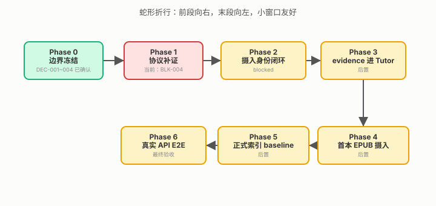
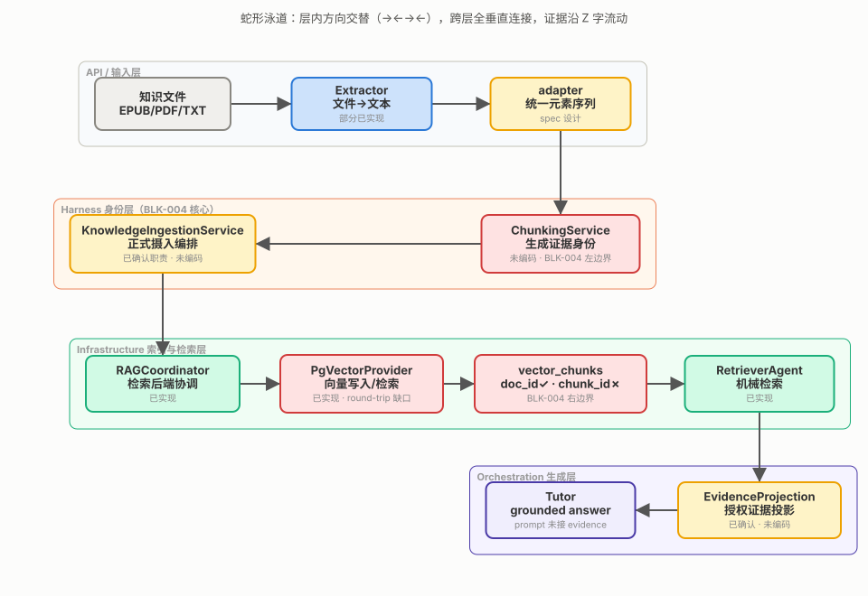
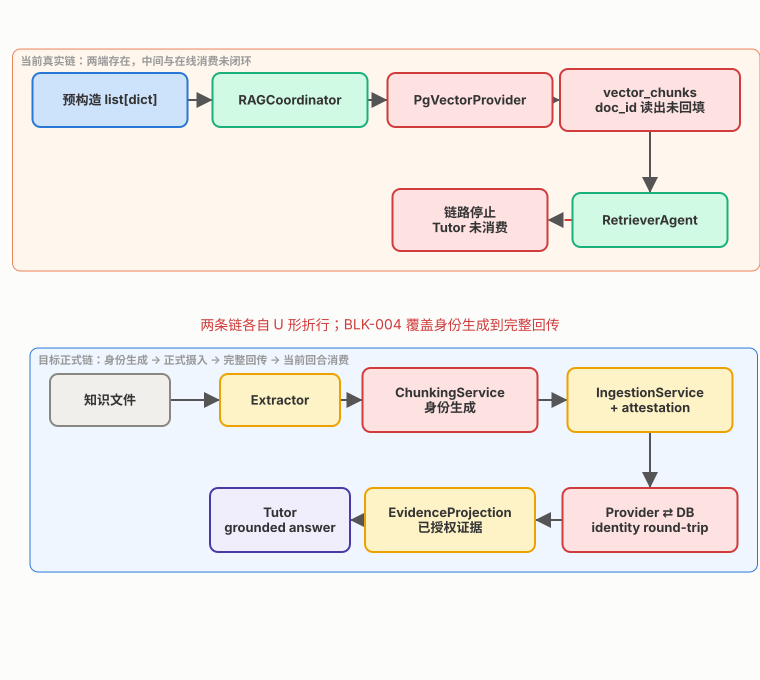

# RAG Foundation · Program Cockpit

> **定位**：RAG Foundation 的常驻背景地图。它回答“最终去哪、当前在哪、子框架怎么组成、主链哪里断了”。静态背景只在这里维护；单项 Decision Canvas 不再复制。  
> **当前状态**：Phase 1 协议补证；BLK-004 为当前 blocker。技术裁决仍在 BLK-004 Decision Canvas 中，尚未确认。  
> **当前决策**：[打开 BLK-004 Decision Canvas](2026-07-28-rag-blk004-decision-canvas.html)。  
> **正式事实源**：blocker 与阶段状态以 `2026-07-24-rag-foundation-parallel-todolist.md` 为准；已确认决策以 `2026-07-27-rag-p0-confirmed-decisions.md` 为准。

---

## 1. 终点与当前位置

最终验收不是“向量库里有数据”，而是：真实 `/api/chat` 与 `/api/chat/stream` 能返回**有权限、可追溯、仅消费当前回合证据**的 grounded answer，并诚实区分无召回、基础设施失败和生成失败（`docs/designs/2026-07-27-rag-foundation-execution-order.md:216-232`）。

> ⚠️ 当前两项裁决只解除 BLK-004 的前置歧义；即使确认，仍需 canonical bytes、测试向量、provider round-trip 与运行证据，BLK-004 才能从 `blocked` 变为完成。

---

## 2. 子框架结构地图

**读图方式**：沿箭头看证据从文件到 Tutor 的生命周期；绿色节点已有代码，黄色节点已有职责/设计但未编码，红色节点是当前缺口或待决边界。BLK-004 左边界是 ChunkingService 产生身份，右边界是 Provider / DB 完整回传身份。

**四条不随单项决策变化的设计约束**：

1. 通用文档只经 KnowledgeIngestionService 正式摄入；extractor 不生成 ID、不写库（`docs/designs/2026-07-27-rag-p0-confirmed-decisions.md:56-79`）。
2. visibility 管“能不能看”，identity 管“看的是哪块”，两者不可互相替代（同上 `:20-40`）。
3. `chunk_id` 标证据本体，`retrieval_id` 标一次检索对证据的使用（同上 `:115-148`）。
4. RAG-D 只消费正式产物与 attestation，不补造摄入链（同上 `:52-67`）。

---

## 3. 当前链与目标链

当前代码已有“预构造 dict → embedding → DB → RetrievedEvidence”，但缺少通用“文件 → ChunkingService → KnowledgeIngestionService”摄入段，也缺少“RetrievedEvidence → Tutor prompt”在线投影段。Provider 查询已读取 `doc_id` 却未回填到 `Chunk.metadata`，是 BLK-004 的已证实 round-trip 缺口（`app/infrastructure/rag/pgvector_provider.py:137-156`）。

---

## 4. ID 与角色分工

这张表保留，因为 ID 关系不是空间结构，而是容易混淆的**语义对照**。

| 标识 | 回答的问题 | 不能替代 |
|---|---|---|
| `source_sha256` | 输入字节是哪一份？ | 具体 chunk |
| `doc_id` | 这是哪份逻辑文档？ | 文档内证据块 |
| `chunk_id` | 检索/评测看到哪一块？ | DB row ID、检索请求 ID |
| `source_locator` | 人去哪里复核？ | 跨格式稳定主键 |
| `ingestion_run_id` | 哪次摄入写入这批数据？ | 内容 identity |
| `retrieval_id` | 这批 evidence 属于哪个问题？ | `doc_id/chunk_id` |
| `parent_id` | 这个事件直接由谁产生？ | 文档/检索单元身份 |
| benchmark `paragraph_id` | gold 在 benchmark corpus 哪里？ | production identity |

---

## 5. 当前进度地图

| 状态 | 项目 | 下一步 |
|---|---|---|
| 已确认 | DEC-001 visibility；DEC-002 摄入职责；DEC-003 retrieval_id；DEC-004 P0 单次尝试 | 作为后续实现约束 |
| 当前 blocker | BLK-004：stable-ID / provenance 契约 | 裁决 `chunk_id` 存储与 range 基线；RAG-B 补 bytes 与测试向量 |
| 后置 | BLK-006 / 007：后端真实性、正式评测与 E2E | BLK-004 解除后推进 |

→ [进入当前 BLK-004 Decision Canvas](2026-07-28-rag-blk004-decision-canvas.html)

---

## 6. 最小名词表

只保留图中出现且望文不能生义的 10 个词；模块职责已在图中标注，不再重复列 40+ 项。

| 名词 | 快速解释 |
|---|---|
| Program Cockpit | 常驻背景地图；静态上下文只在这里维护 |
| Decision Canvas | 单项决策增量包；只放当前裁决所需信息 |
| provenance | 证据来源与身份链：从哪份输入、哪次切块、如何写入和回传 |
| canonical bytes | 计算稳定 ID 前、跨实现无歧义的字节表示 |
| range | chunk 在规范元素流中的坐标范围 |
| round-trip | identity 从写入 DB 到检索返回全程不丢失 |
| attestation | 版本化摄入证明，记录输入与实际写入结果 |
| EvidenceProjection | Orchestrator 投给 Tutor 的受限、已授权证据快照 |
| grounded answer | 明确由当前正式、已授权证据支撑的回答 |
| fail closed | 授权信息不明确时默认拒绝，不冒险召回 |

## 7. 事实出处索引

- blocker 主账本：`docs/designs/2026-07-24-rag-foundation-parallel-todolist.md`
- 已确认决策：`docs/designs/2026-07-27-rag-p0-confirmed-decisions.md`
- 阶段与验收：`docs/designs/2026-07-27-rag-foundation-execution-order.md`
- Chunking 设计草案：`docs/designs/2026-07-24-project-chunking-service-spec.md`
- 实际检索结构：`app/infrastructure/rag/coordinator.py:7-175`
- Provider 存取与缺口：`app/infrastructure/rag/pgvector_provider.py:22-187`
- 表结构：`app/models/tables.py:92-111`
- 当前 Retriever：`app/agents/retriever.py:24-101`
- 当前 Tutor prompt：`app/agents/tutor.py:74-97`
