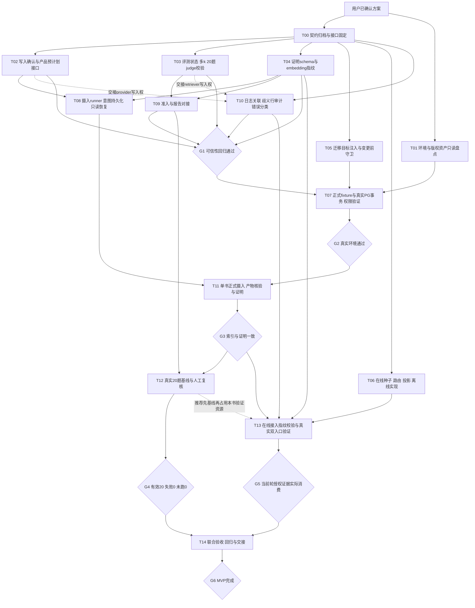

# RAG MVP DAG 与并发调度

日期：2026-10-16。依据：[已确认执行方案](2026-10-15-rag-mvp-execution-plan.md)。用户已确认执行方案；本次只规划依赖和调度，不启动实现。原 S0～S6、E1～E6、R01～R27 编号保留，T00～T14 为执行工作包，不替换问题编号。

就绪状态增量：初次[就绪核查](2026-10-16-execution-readiness-audit.md)后，已完成[T00冻结及v1.0.1勘误](2026-10-16-t00-contract-freeze-record.md)，[首批T02/T03/T04独立plan](../../docs/rag-work/plans/2026-10-16-execution-plan-index.md)也已编写并通过当前主窗口review。仅首批材料就绪，其他包仍需逐包plan；本次未派发业务编码。以下是调度设计，不是实现完成声明。

## 1. 图的阅读方式

实线表示产物/验证前置，必须满足才能完成下游包；虚线表示推荐调度顺序或共享文件的写入权交接，不应误称业务技术依赖。所有实现包的“完成”包含本包必要测试和主会话复核；仅实现函数不能释放验收门。任务可以提前设计或使用契约替身开发，真实里程碑只接受真实证据。

S4 基线先于 S5 是原方案建议的排查顺序；并发调度可提前做 S5 的离线实现，但本书在线真实验证推荐在基线运行完成并释放资源后进行。

## 2. 工作包 DAG

T10 与 T02/T03 的虚线是资源依赖：其业务设计只需 T00 契约，但实际写入必须等现有文件所有者释放。若以后用隔离工作树并行实现，也需串行合并和回归，不删除这项集成成本。

## 3. 每包前置、产物与范围

| 包 | 映射与职责 | 硬前置 | 主要产物/边界 |
|---|---|---|---|
| T00 | S0-01/02/03/05/06/07；主控 | 方案确认 | 固定字段、错误、证明/恢复、embedding指纹、迁移注入和投影契约；同步 spec 引用 raw 来源；本轮确认不需要重复请求同一方案批准 |
| T01 | S0-04；只读资源盘点 | 方案确认 | 资产/源SHA可用性、PG/embedding条件、测试/lint现状；不运行写库迁移、不泄露密钥 |
| T02 | E1 + E3 的 prepare_file/ingest_prepared | T00 | 可信写入、准备结果和无正文计划接口；服务贯通用例，默认接口兼容 |
| T03 | E2；S1-02/04/07/08 | T00 | 同次多k、outcome保真、20题不变量、judge逐项校验及严格JSON；不与另一代理同时改评测文件 |
| T04 | E3 共享schema、指纹与验证纯逻辑 | T00 | 生产与消费共同调用的证明验证/embedding指纹接口；独立新文件，不抢改 T02 的 embedding.py |
| T05 | E4；S2-01/05 的迁移入口与守卫实现 | T00 | env.py 接受已预检连接；A/B目标对抗的离线/受控验证，不宣称真实PG已完成 |
| T06 | E5；S5-01～05 的离线核心 | T00 | seed/rule/conductor、Orchestrator、Tutor、Critic、投影及假数据回归；不改 T03 的 retriever.py，不假称真实证据已验收 |
| T07 | E4；I-01及S2真实验证 | T05、T01、G1 | fixture消费正式schema、实际PG迁移/维度/事务/权限/identity验证；独立测试资源、无基线污染；包含G2复核 |
| T08 | E3；S3 runner与恢复实现/受控测试 | T02、T04 | 持久化预意图和计划、写入一次、实际产物核对、提交后只读补证；正式摄入另由 T11 完成 |
| T09 | E2/E3；S1-03与S4报告消费层 | T03、T04 | benchmark调用共享schema，绑定目标/指纹/隔离证据、完成计数；可用受控输入验证，不造产品证明 |
| T10 | E5；S1-05 | T00 | 关联上下文、无正文歧义审计及已有错误归类；写入还受 T02/T03 完成约束 |
| T11 | S3-01～06真实运行 | G2、T08 | 本书索引、预意图、产物多重清单、成功证明、恢复验收；包含G3复核，独占目标 |
| T12 | S4-01～05 | G3、T09 | 完整20题一次运行、raw报告、指标与异常题复核；judge可降级，检索失败不能放行G4 |
| T13 | E5/E6；S5真实验证、S6-01/02前置 | G3、T06、T10、T04 | 本书查询指纹匹配、普通/SSE、两用户/多轮/重复事件/降级路径；包含G5复核 |
| T14 | E6；S6及最终交接 | G4、G5 | 联合回归、必要CI、证据索引、README/主清单/交接同步；主控核验后G6完成 |

G1 是 S1 的集成门：T02/T03/T04/T09/T10 都必须通过，不允许一个分支完成就直接正式摄入。T05 的迁移实现可提前，真正PG执行留在 T07。

## 4. 最大并发的三个口径

1. **逻辑任务宽度**：只考虑产物硬依赖、不考虑文件写入权时，上图最大宽度为七，示例为 T01/T02/T03/T04/T05/T06/T10。但 T10 会与 T02/T03 抢写文件；加入两条写入权交接约束后最大宽度为六，示例为 T01/T02/T03/T04/T05/T06。这两个数是本次工作包粒度的依赖图宽度，不是可运行子代理数。
2. **本会话容量**：当前最多四个活动 agent，包含主会话。因此保留主会话做契约、审阅和集成时，最多同时派发三个子代理工作包。主会话可以同步做只读核查/文档和复核，不作为第四个并发代码写入者。
3. **资源实际并发**：满足前置不代表一定能并跑。共享文件、共享测试数据库、同一版本证明输出、同一连接和正式本书运行都需单写/独占。实际就绪不足时降到一或两个子代理，不为占满槽位拆造无价值工作。

上述宽度已按工作包前置关系检查无环并枚举最大互不依赖集合；只对本文件粒度成立。包内细分可改变数学宽度，也会增加评审/合并成本。没有实测任务时长，不承诺三倍提速、最优工期或唯一关键路径。

## 5. 三子代理的推荐调度

每行是调度窗口，不是固定时长批次。一个包通过复核就释放槽位，按依赖派发下一包，不必等待该行其他包全部完成；跨包共享文件必须完成写入权交接。

| 窗口 | 子代理A | 子代理B | 子代理C | 主会话与释放条件 |
|---|---|---|---|---|
| W0 | T01 只读盘点 | 空闲 | 空闲 | T00契约归档、范围/接口固定；完成后释放各实现分支 |
| W1 | T02 写入与预计划 | T03 评测核心 | T04 schema与指纹 | 主控逐包审阅；三条互不抢文件，优先可信性主链 |
| W2 | T08 runner（T02/T04完成后） | T09门禁报告（T03/T04完成后） | T05迁移守卫 | 如对应前置尚未齐，优先在空槽安排T05或T06，不阻塞等待 |
| W3 | T10日志审计（T02/T03释放文件后） | T06在线离线核心 | T07准备/执行（G1通过且T05/T01完成后） | G1未通过时T07不得执行真实验证；该槽可做审阅或保持空闲 |
| W4 | T11正式摄入（G2/T08完成后） | T06剩余离线测试或专项只读审阅 | 释放/专项只读审阅 | 不并发第二个摄入，不为填满槽重复运行同一产品链；核对G3 |
| W5 | T12正式基线 | T13的离线集成/测试准备 | 审阅可用产物 | T13真实本书请求待T12释放资源后执行；T13此时不重复修改T06未交接文件 |
| W6 | T13真实双入口/安全验证 | 已有证据只读复核 | 释放 | G4/G5都通过后，主控主导T14与G6；文档主清单只由主控写 |

W3 的 T10 与 T07 不保证同时运行：T07必须等待T10等分支形成G1证据。该表明确按就绪情况滚动调度，不把三个标签误认为三个必定可同时执行的包。

若环境 T01/T07 阻断，继续 T03/T04/T06/T08/T09/T10 的纯逻辑实现与测试；G2/G3/G4/G5/G6 的真实验收保持阻断，禁止将 fake 报告顶替。

## 6. 文件与环境写入权

| 资源 | 写入顺序/所有者规则 |
|---|---|
| pgvector_provider.py、embedding.py、knowledge_ingestion.py | T02先持有；T10在释放provider后补审计；T07只在相关文件写入稳定后做真实集成 |
| retriever.py、其评测测试 | T03先持有，T10随后补运行日志/错误；T06不改此文件，需变更通过主控串行安排 |
| rag_d.py、test_rag_d.py | T03先完成核心结果与20题规则，T09接续门禁/报告，禁止两人同时改同一文件 |
| 新证明/指纹模块与对应测试 | T04独占；T08/T09以已固定接口消费，不能各自复制schema或直接抢改共享模块 |
| alembic/env.py | T05独占；T07消费并负责fixture收敛，生产迁移入口保持受控 |
| provider unit/integration fixture | T02相关测试完成后再由T07收敛正式迁移；T10如需改相同测试，先交接，不并写 |
| assembly/orchestrator/tutor/critic及对应测试 | T06独占，T13接续集成；T10不扩张到这些文件，日志契约由接口对接 |
| 正式迁移/权限测试PG资源 | T07独占；用可辨认测试目标，绝不借用业务或基线目标作破坏性样本 |
| 本书索引、证明输出 | T11唯一摄入；运行期间禁止其他writer，未决恢复前不启动新run |
| 同一基线实例及provider连接 | T12串行20题，每题一次，不以三子代理分摊同一共享连接/runner |
| 本书在线验证资源 | T12正式运行完成并释放后交T13；不在基线运行中改索引/配置或触发另一轮评测 |
| 主清单、README、批准记录 | 主会话单写；各窗口状态仍遵守原唯一写者协议 |

以上限制在共享工作区尤为必要。若实际采用工作树，必须用原生工作树流程获取隔离目录并明确变更归并；不能因目录隔离而绕过数据库独占、接口依赖和单写者文档规则。

## 7. 阻断链与调度优先级

无法在没有时长估计时给出唯一关键路径；当前有两条主要阻断链：

- 数据可信链：T00 → T02/T04 → T08，以及T03/T04 → T09 → G1 → T07/G2 → T11/G3 → T12/G4 → T14。
- 在线消费链：T00 → T06；T02/T03释放后T10 → G1；T06 + T10 + G3 + embedding指纹 → T13/G5 → T14。

资源准备T01、迁移守卫T05同样可以成为G2的实际瓶颈。优先派发T02/T03/T04，随后尽早填入T05；T06用于并行推进和环境等待时填补。T08/T09共享契约就绪后优先释放真实摄入和G1，不被非阻断文档美容挤占。

最早可获得的里程碑分别是可信性G1、真实环境G2、单书摄入G3、完整基线G4、在线消费G5。MVP只在G4和G5同时成立且T14回归/交接完成后放行，不把任何一个局部完成说成整体完成。

## 8. 派发与验收约定

每次派发只包含：已确认契约与spec引用、该包输入/输出、允许写入文件、禁止碰触资源、必要测试和交付证据。子代理完成后主控审阅，通过才释放下游；测试失败属于原包修复，不启动未满足前置的真实任务。

主会话不重复索取本次已确认方案的批准；遇到超出MVP范围、新共享业务语义或真实资源缺失时，记录具体差异再处理。工具平台故障按既有每轮最多重试一次纪律，暂停相应变更而继续不受影响的只读工作。正式运行和长测试主动轮询，不使用sleep。

本轮仅完成DAG和调度文档，未派发实现、未创建工作树、未运行生产或真实数据库任务。
